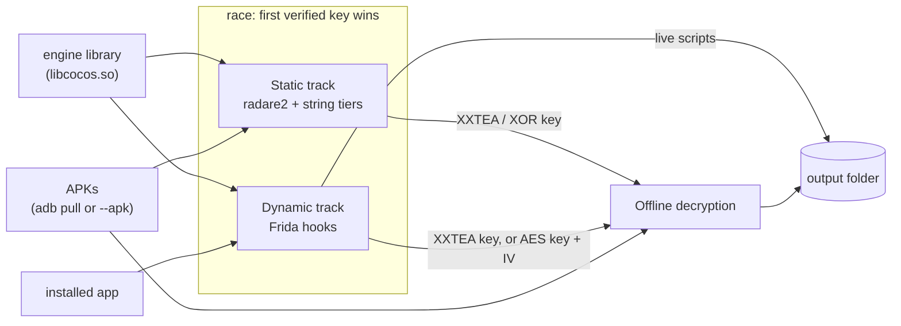

<p align="center">
  
</p>

<h1 align="center">coconuts</h1>

<p align="center">Dump and decrypt Cocos2d-x / Cocos Creator scripts and assets from an Android app.</p>

Cocos2d-x and Cocos Creator games ship their JavaScript game logic inside the APK as encrypted `.jsc`
files, usually XXTEA with the key compiled into the native engine library. **coconuts** recovers that
key, either by reading it out of the library statically, by catching it at runtime with Frida, or
both at once. It then writes the decrypted scripts to a folder you can read, diff and grep. For
AES-protected builds it decrypts every asset, not just the scripts.

- **Two key-recovery tracks racing in parallel.** Static analysis of the engine library with radare2,
  and dynamic capture with Frida. The first verified key wins and the other track is stopped.
- **Live script dumps.** Frida hooks the engine's script evaluator, so you also get scripts downloaded
  by hot updates, which never appear in the APK.
- **Three encryption schemes.** Cocos XXTEA (with or without a signature prefix), repeating-key XOR,
  and x-studio / axmol `EncryptManager` AES-256-CBC.
- **Fails soft.** Discovered keys are checked against real files before they're used. When nothing
  works you still get the raw `.jsc` files, and a missing device, Frida or radare2 only disables the
  part that needs it.

## Contents

- [Goals](#goals)
- [How it works](#how-it-works)
- [Supported encryption schemes](#supported-encryption-schemes)
- [Requirements](#requirements)
- [Install](#install)
- [Preparing the library and the device](#preparing-the-library-and-the-device)
- [Linux and x86 PCs](#linux-and-x86-pcs)
- [Usage](#usage)
- [Output](#output)
- [Troubleshooting](#troubleshooting)
- [Limitations](#limitations)
- [Project layout and development](#project-layout-and-development)
- [Responsible use](#responsible-use)
- [License](#license)

## Goals

coconuts gets you from "a Cocos game installed on a phone" to "readable JavaScript" with one command,
without knowing in advance how that particular build protects its scripts.

- **One command, no prior knowledge.** You give it the engine library and the package name. It works
  out the scheme, the key and any signature prefix.
- **Use every source of truth available.** A key stored in the binary is found in milliseconds. Frida
  covers keys that are obfuscated, computed at runtime or otherwise not sitting in the strings.
  Running both at once means you wait for whichever is faster, not for both.
- **Never use an unverified key.** Every key coconuts discovers is test-decrypted against real files
  from the APK first. A wrong key never produces a folder of garbage.
- **Keep what can't be decrypted.** If no key works, the raw files are saved for manual work.

Non-goals:

- **Decompiling.** Compiled SpiderMonkey bytecode is written out as-is (`.mozjs.jsc`), and bundled or
  minified JS is not beautified.
- **Lua, iOS or HTML5 builds.** coconuts handles Android builds that use the JavaScript engine (`.jsc`
  scripts). Cocos2d-x Lua games (`.luac`) are out of scope.
- **Bypassing anti-tamper.** If a game detects Frida or root and exits, the dynamic track fails. The
  static track still runs.

## How it works



### The race

Both tracks start together.

- **The static track** runs in a background thread. It pulls the APKs from the device (or reads the
  ones you pass with `--apk`), collects every `assets/**/*.jsc`, and searches for a key.
- **The dynamic track** resolves where to hook in the library, spawns the game under Frida and waits
  for the engine to use its key.

Whichever track produces a key first stops the other: radare2 processes are killed, the Frida session
is detached and the game is closed. If the static track wins early, Frida never launches the game.

A key captured by Frida is checked against the `.jsc` files once the race ends. If it doesn't decrypt
them (the hook caught some other call), coconuts discards it and runs the static search to completion.

### Static track

First comes an instant **XOR check**: a known-plaintext attack against the files most likely to have
known contents (`jsb-builtin`, `jsb-engine` and `jsb_polyfill` first). It XORs their opening bytes
with plaintexts every Cocos2d-js build starts with: the bundle prelude
`(function(){function r(e,n,t){…` and the SpiderMonkey bytecode magic. A repeating printable key of up
to 32 bytes falls straight out, in under a millisecond.

If that fails, coconuts gathers **XXTEA key candidates** from the engine library, in order of
likelihood:

| Tier | Where candidates come from |
|---|---|
| 0 | radare2 disassembles only the functions that set the key (`AppDelegate::applicationDidFinishLaunching`, `jsb_set_xxtea_key`, `setXXTeaKey`) and collects the string literals they reference. |
| 1 | Strings right next to Cocos boot anchors in read-only data. First a tight 128-byte window before `main.js`, `jsb-adapter/jsb-builtin.js`, `0.0.0.0` and the detected signature prefix. Then a wider 512-byte window around `main.js`, `jsb-adapter`, `jsb_polyfill` and `project.jsc`. |
| 2 | 14 to 16 character tokens anywhere in the binary that match common generated-key shapes, such as UUID fragments like `1a2b3c4d-5e6f-7a` or 16 alphanumerics. |
| 3 | Every other printable 4 to 32 character token without spaces, slashes or format characters. |

Each candidate is zero-padded or truncated to 16 bytes, exactly as the engine does. It is then used to
decrypt the three smallest `.jsc` files. It's accepted only if all three come out with a valid XXTEA
length word **and** decode to something script-like: UTF-8 text, a gzip stream, a zip archive or
SpiderMonkey bytecode.

### Dynamic track

1. **Resolve hook targets with radare2.**
   - The library must be arm64 and export a `Java_…JavascriptJavaBridge…` JNI symbol. That symbol
     identifies the Cocos JS engine, and the hook uses it at runtime to recognise the right library.
   - The **key function** is `xxtea_decrypt` from the symbol table. If that symbol is missing,
     coconuts tries the `setXXTeaKey` slot in `.data.rel.ro`. As a last resort it runs a full radare2
     analysis (`aap; aaef`), finds the function that references `"Can't decrypt code for %s"`, and
     picks the XXTEA call inside it.
   - The **script dump function** is `ScriptEngine::evalString` / `ScriptingCore::evalString`, found
     by symbol or through cross-references to its error strings.
   - Full analysis can take minutes. It waits until the static track has tried its high-probability
     candidates (tiers 0–2), and it's killed the moment the static track wins.
2. **Spawn and hook.** coconuts spawns the game suspended, injects
   [`frida_hook.js`](coconuts/frida_hook.js) and resumes it. The hook watches the dynamic linker
   (`do_dlopen`) and installs these hooks as soon as the Cocos library loads:
   - `evalString`: every script the engine evaluates is streamed back and written to the output
     folder.
   - `xxtea_decrypt`, `setXXTeaKey` and `jsb_set_xxtea_key`: capture the XXTEA key.
   - `EncryptManager::setEncryptEnabled`: captures the AES key, IV and flags, which carry the
     signature roll count.
3. **Wait, then collect.** coconuts waits up to `--timeout` seconds for a key, then keeps the session
   open another `--live-seconds` seconds to collect live dumps.

### Offline decryption

- **Inputs.** APKs are pulled with `adb shell pm path`, skipping `split_config.*` APKs unless you pass
  `--all-splits`. Or you pass APK/zip files or directories with `--apk`.
- **Signature prefix.** Some builds prepend a fixed signature to every encrypted file (Cocos's
  `setXXTEAKeyAndSign`). coconuts detects the common prefix across files and strips it. Override with
  `--sign`.
- **Unpacking.** After decryption, gzip streams are inflated. Zip archives (Creator's "zip compress"
  option) are saved as `.zip`, SpiderMonkey bytecode as `.mozjs.jsc`, and plain text as `.js`.
- **Live dumps win.** A file already written by a live dump isn't overwritten, since the live copy is
  what the game actually ran.
- **AES mode.** `EncryptManager` encrypts every asset type, so every asset is processed. The key is
  first verified against the `.jsc` files. Assets that then don't decrypt are genuinely unencrypted
  and are copied verbatim.

## Supported encryption schemes

| Scheme | Where it's used | How coconuts gets the key |
|---|---|---|
| **Cocos XXTEA** (`.jsc`), optionally with a signature prefix | Cocos2d-x JS and Cocos Creator native builds with "encrypt JS" enabled | Static tiers, Frida hooks, or `--key` |
| **Repeating-key XOR** (`.jsc`) | Some modified Cocos2d-js engines | Known-plaintext attack (automatic) |
| **EncryptManager AES-256-CBC** (all assets) | x-studio / axmol `EncryptManager::setEncryptEnabled` | Frida hook, or `--aes-key` / `--aes-iv` |

Payloads can additionally be gzip- or zip-compressed. Both are handled after decryption.

For reference, the AES layout is `AES-256-CBC(PKCS7(zlib(plaintext)))` followed by a 16-byte trailer.
The trailer is encrypted with AES-128-ECB and is valid when `mask ^ sigval == 0xDEADBEEF`. Its key is
derived from the key and IV through `roll` rounds of AES-128-ECB. `roll` defaults to 5 and is read
from the captured flags when Frida catches the key.

## Requirements

| Requirement | Needed for | Notes |
|---|---|---|
| Python ≥ 3.9 | everything | The Python dependencies (`frida-tools`, `r2pipe`, `xxtea`, `pycryptodome`) are installed for you. |
| [radare2](https://github.com/radareorg/radare2) on `PATH` | Frida hook resolution; static tier 0 | Without it the dynamic track can't run, but static tiers 1–3 still work. `brew install radare2` on macOS; on Linux see [Installing on Debian](#installing-on-debian). |
| adb (Android platform-tools) | Pulling APKs and picking the device | Found on `PATH`, `$ANDROID_HOME`, `$ANDROID_SDK_ROOT`, `~/Library/Android/sdk` or `~/Android/Sdk`. Not needed with `--apk --static-only`. |
| frida-server, running as root on the device | Dynamic track | Must match the `frida` version coconuts installed. See [below](#running-frida-server). |
| An **arm64** device or emulator with the game installed | Dynamic track | Hook offsets come from the arm64 library, so the game must run its arm64 build. Apple-silicon emulators and real phones work. Any device or emulator will do for just pulling APKs. On an x86 PC, see [Linux and x86 PCs](#linux-and-x86-pcs). |

## Install

```sh
# Recommended: an isolated install with pipx
pipx install git+https://codeberg.org/davidjosearaujo/coconuts

# Or from a local checkout
git clone https://codeberg.org/davidjosearaujo/coconuts
cd coconuts && pipx install .

# Or for development (editable install)
python3 -m venv .venv && . .venv/bin/activate && pip install -e .
```

This gives you a `coconuts` command. From a checkout you can also run `python3 -m coconuts`.

> **`xxtea` vs `xxtea-py`:** coconuts depends on the C-accelerated
> [`xxtea`](https://pypi.org/project/xxtea/) package. If you install dependencies by hand, make sure you
> get `xxtea`, **not** `xxtea-py`. Both provide a module called `xxtea`, but only the former has the
> API coconuts uses. With the wrong one, coconuts warns at startup and falls back to a pure-Python XXTEA
> that's about 150× slower.

## Preparing the library and the device

### Getting the engine library

The first argument is the game's **arm64** native engine library:

- `libcocos.so` for Cocos Creator 3.x
- `libcocos2djs.so` for Cocos2d-x JS and Cocos Creator 2.x

Pull it from the installed app:

```sh
adb shell pm path com.example.game
#   package:/data/app/~~…/com.example.game-…/base.apk
#   package:/data/app/~~…/com.example.game-…/split_config.arm64_v8a.apk   ← only if the app uses splits
adb pull /data/app/~~…/com.example.game-…/base.apk
unzip -j base.apk 'lib/arm64-v8a/libcocos*.so'
```

If `base.apk` has no `lib/` folder, the native libraries live in `split_config.arm64_v8a.apk`. Pull
that one and unzip from it instead.

### Running frida-server

Only the dynamic track needs this. Skip it if you'll use `--static-only`.

```sh
# 1. Find the frida version coconuts uses
pipx runpip coconuts show frida | grep -i '^version'

# 2. Download frida-server-<that version>-android-arm64.xz from
#    https://github.com/frida/frida/releases, then:
unxz frida-server-*-android-arm64.xz
adb root                     # emulators: use a "Google APIs" image ("Google Play" images can't adb root)
adb push frida-server-*-android-arm64 /data/local/tmp/frida-server
adb shell chmod 755 /data/local/tmp/frida-server
adb shell '/data/local/tmp/frida-server >/dev/null 2>&1 &'
#   on a rooted phone instead:  adb shell "su -c '/data/local/tmp/frida-server &'"
```

The game must be installed, but you don't need to start it. coconuts spawns it itself.

## Linux and x86 PCs

coconuts runs on an x86_64 PC just as it does on a Mac. Nothing it runs  is ARM-specific.

What changes is **which Android device you can use**. The Frida track needs the game to run its arm64 native code, and the Android Emulator on an x86 PC can't provide that (see [why](#why-x86_64-emulators-cant-be-hooked)).

### Choosing a setup

| Setup | Static track | Frida track |
|---|---|---|
| 1. A rooted arm64 phone over USB | ✓ | ✓ |
| 2. No device, with an APK you already have | ✓ | — |
| 3. An x86_64 emulator | ✓ (as the APK source) | — |

Without the Frida track you lose three things:
- **Keys that aren't stored as plain strings** in the library, for example obfuscated or computed ones.
- **Live dumps**, and with them any hot-updated scripts.
- **`EncryptManager` AES key capture.** AES-protected games then need a key and IV you already know
  (`--aes-key`, `--aes-iv`).

**1. A rooted arm64 phone over USB (recommended).** Everything works. Your PC only drives the phone, so
coconuts takes the same arm64 path that's been tested on arm64 emulators.
- frida-server needs root, for example through Magisk. Start it with the `su -c` line in
  [Running frida-server](#running-frida-server).
- Wireless debugging (`adb connect`) should also work, since Frida finds Android devices through
  adb, but it hasn't been tested. Pass the `ip:port` serial with `--device`.

**2. No device: static only.** This works on any PC:

```sh
coconuts ./libcocos.so com.example.game ./out --static-only --apk ./base.apk
```

You need the APK and the engine library from inside it, for example from your own build or pulled
from a device earlier.

**3. An x86_64 emulator, as an APK source.** Install the game in an x86_64 emulator (a "Google Play"
system image lets you install it from the Play Store) and let coconuts pull the APKs:

```sh
coconuts ./libcocos.so com.example.game ./out --static-only
```

Always pass `--static-only` here. Without it, the Frida track spawns the game and waits the full
`--timeout` for a key that never comes.

To get the library from the emulator, follow [Getting the engine library](#getting-the-engine-library).
The emulator may have installed `lib/x86_64/` (in `split_config.x86_64.apk`) instead of
`lib/arm64-v8a/`. That's usually fine for the static search: the key is a build setting, compiled
into every ABI's library, and the search mostly reads strings. It has only been tested with arm64
libraries, though.

### Installing on Debian

```sh
sudo apt install pipx adb android-sdk-platform-tools-common
pipx ensurepath                 # then open a new terminal
pipx install git+https://codeberg.org/davidjosearaujo/coconuts
```

- **radare2.** Install a current release rather than Debian's package, which tends to lag far behind.
  Either download `radare2_<version>_amd64.deb` from the
  [releases page](https://github.com/radareorg/radare2/releases) and run
  `sudo apt install ./radare2_*_amd64.deb`, or build it with
  `git clone https://github.com/radareorg/radare2 && radare2/sys/install.sh`.
- **pipx, not pip.** Debian blocks system-wide `pip install`, so use pipx as above, or a virtualenv.
- **`adb devices` shows the phone as `no permissions`.** That's USB access.
  `android-sdk-platform-tools-common` installs the udev rules, so replug the phone. If it persists,
  run `sudo usermod -aG plugdev $USER` and log in again.
- **Debian's adb is too old for your phone**, for example it has no `adb pair` for wireless debugging.
  Use Google's [platform-tools](https://developer.android.com/tools/releases/platform-tools) instead.
  coconuts finds adb on `PATH` and in `~/Android/Sdk`, where Android Studio installs it on Linux.
- **coconuts warns `Fast XXTEA unavailable`.** If `xxtea` had to be built from source and the build
  failed, install `build-essential python3-dev` and run `pipx reinstall coconuts`.

### Why x86_64 emulators can't be hooked

- **The emulator can't run arm64 Android.** On an x86 PC the Android Emulator runs x86_64 system
  images. arm64 images either aren't offered for x86 hosts or run far too slowly to use.
- **ARM-only games run through translation.** Many Cocos games ship only ARM native libraries. In an
  x86_64 image, Android runs those through an ARM translation layer, and Frida can't hook code running
  inside it.
- **x86_64 game builds aren't supported yet.** Even games that do ship x86_64 libraries can't be hooked
  yet, because coconuts' hook resolution only handles arm64 libraries.

To see which build a game is running:

```sh
adb shell dumpsys package com.example.game | grep -i cpuabi
#   primaryCpuAbi=arm64-v8a   ← on an x86_64 emulator: the ARM build, running under translation
#   primaryCpuAbi=x86_64      ← an x86_64 build, which the Frida track doesn't support yet
```

## Usage

```
coconuts [options] LIB PACKAGE [OUTPUT]
```

- `LIB` is the arm64 engine library. It's always required, even when you pass a key.
- `PACKAGE` is the app's package name. It's used to pull the APKs and to spawn the game. It's still
  required, but unused, when nothing touches the device.
- `OUTPUT` is the output folder. The default is `dumped_cocos_assets`.

### Common recipes

```sh
# Default: pull the APKs, race static vs. Frida, decrypt everything
coconuts ./libcocos.so com.example.game ./out

# Several devices connected: choose one (adb serial, also used as the Frida device id)
coconuts ./libcocos.so com.example.game ./out --device emulator-5554

# Slow-starting game: wait longer for the key, then keep dumping hot-updated scripts for a minute
coconuts ./libcocos.so com.example.game ./out --timeout 60 --live-seconds 60

# No device at all: static search against a local APK, or a folder of .jsc files
coconuts ./libcocos.so com.example.game ./out --static-only --apk ./base.apk
coconuts ./libcocos.so com.example.game ./out --static-only --apk ./unzipped_apk/

# Base APK plus a feature split that also carries scripts
coconuts ./libcocos.so com.example.game ./out --static-only --apk base.apk --apk split_game.apk

# You already know the key (and, optionally, the signature prefix)
coconuts ./libcocos.so com.example.game ./out --apk ./base.apk --key 1a2b3c4d-5e6f-7a --sign kkk

# EncryptManager AES assets, using the key and IV from an earlier Frida capture
coconuts ./libcocos.so com.example.game ./out --apk ./base.apk \
    --aes-key e7895ce80904fced... --aes-iv 9f9da80fee3290bf... --aes-roll 5
```

### Modes

| Flags | APKs come from | Static track | Frida track |
|---|---|---|---|
| *(none)* | the device (adb) | ✓ | ✓ |
| `--apk …` | local files | ✓ | ✓ (still spawns the game on the connected device) |
| `--static-only` | the device, or `--apk` | ✓ | — |
| `--key` | the device, or `--apk` | — (your key is used directly) | — |
| `--aes-key` | the device, or `--apk` | — (AES mode with your key) | — |

### Options

| Option | Default | Description |
|---|---|---|
| `--device SERIAL` | the only connected device | adb serial, also used as the Frida device id. Fails if several devices are connected and none is chosen. With `--apk` and no `--device`, Frida uses the first USB device. |
| `--timeout SEC` | `10` | How long Frida waits for a key after spawning the game. |
| `--live-seconds SEC` | `5` | How long to keep the Frida session open after the key, collecting scripts as the game evaluates them. Ctrl-C ends it early and moves on to decryption. |
| `--static-only` | off | Skip Frida entirely. |
| `--key KEY` | — | A known XXTEA key, as text. It's zero-padded or truncated to 16 bytes, as Cocos does. Skips key discovery. |
| `--sign SIGN` | auto-detect | The signature prefix to strip from every `.jsc`. `--sign ''` disables stripping. |
| `--aes-key HEX` | — | An EncryptManager AES key. Switches to AES mode, which processes every asset. |
| `--aes-iv HEX` | 16 × `0x01` | The AES IV. The default is EncryptManager's value for an empty IV. |
| `--aes-roll N` | `5` | The signature roll count. Read from the captured flags automatically when Frida catches the key. |
| `--apk PATH` | — | A local APK/zip or a directory to read assets from, instead of pulling from the device. Repeatable. Zip files are read from their `assets/` folder. For directories, a leading `assets/` is stripped from paths. |
| `--all-splits` | off | Also pull `split_config.*.apk`. Language, density and ABI splits are skipped by default because they never contain scripts. |
| `-v`, `--verbose` | off | Debug output: per-file decryption failures, radare2 and Frida details, tracebacks. |
| `--no-color` | off | Disable ANSI colours. You can also set `NO_COLOR` or `TERM=dumb`. Colours are off automatically when stderr isn't a terminal. |

## Output

The output folder mirrors the APK's `assets/` tree, with `.jsc` renamed to `.js`. For example
(paths depend on the game):

```
out/
├── main.js                       # decrypted from assets/main.jsc
├── src/
│   ├── project.js
│   └── settings.js
├── jsb-adapter/
│   └── jsb-builtin.js
├── src/bundle.js.zip             # payload was a zip archive ("zip compress" builds)
├── src/legacy.js.mozjs.jsc       # payload was compiled SpiderMonkey bytecode
└── raw_jsc/                      # only when no key worked: the untouched .jsc files
```

- **Live dumps** from Frida land in the same folder, under the path the engine reported. That's how
  hot-updated scripts that exist nowhere in the APK show up.
- **Paths that would escape the output folder** (for example `../`) are refused.
- **In AES mode** every asset is written: decrypted where it was encrypted, copied verbatim where it
  wasn't.

### Reading the log

```
[*] Racing the static key search against Frida...
[*] frida: xxtea_decrypt found in the symbol table at 0x1a2b3c0
[*] frida: Spawning com.example.game on Android Emulator 5554
[*] static: Found 214 .jsc asset(s) across 1 input path(s).
[*] frida: Hooks installed in libcocos.so @ 0x7a1c000000
[+] frida: Key captured: '1a2b3c4d-5e6f-7a'
[*] static: Frida captured the key first; stopping the static search.
[*] frida: Collecting live dumps for 5s more (Ctrl-C to stop early)...
[+] frida: Saved 37 live script dump(s) to ./out
[+] frida: Key verified against 3 .jsc file(s).
[*] Decrypting 214 asset(s) into './out' with XXTEA key '1a2b3c4d-5e6f-7a'...
[+] Done: 177 file(s) decrypted to ./out, 37 skipped (already dumped live).
```

The log above is abridged; your paths, counts and key will differ. `[*]` is progress, `[+]` a result,
`[!]` a warning, `[-]` an error and `[.]` debug output (with `-v`). Lines from the two tracks are
prefixed `static:` and `frida:`.

### Exit codes

| Code | Meaning |
|---|---|
| `0` | The run completed. **This includes runs where no key worked.** Look for `[-] No working key found` and an `OUTPUT/raw_jsc/` folder. |
| `1` | coconuts couldn't start or couldn't get its inputs. For example: the library path doesn't exist, `--aes-key` / `--aes-iv` aren't valid hex, adb or the device is unusable, or no APKs could be obtained. |
| `130` | Interrupted with Ctrl-C outside the Frida wait. Ctrl-C during the Frida wait only ends the capture early, and decryption still runs. |

## Troubleshooting

**`[!] Fast XXTEA unavailable; using the ~150x slower pure-Python version`**
The wrong `xxtea` package is installed, or it failed to build. Everything still works, just slowly.
Fix it with `pip uninstall xxtea-py && pip install xxtea`. Under pipx, use
`pipx runpip coconuts uninstall -y xxtea-py` and then `pipx runpip coconuts install xxtea`.

**Device errors** (`No Android device or emulator found`, `unauthorized`, `offline`, `hasn't finished booting yet`, `Multiple devices connected`)
Each message says what to do. To leave the device out entirely, use `--static-only --apk …`.

**`frida: Failed (…); continuing with the static track.`**
The dynamic track couldn't start. Common causes:
- frida-server isn't running, isn't root, or doesn't match the installed `frida` version.
- radare2 isn't installed.
- The library isn't arm64 (`Only arm64 libs are supported`), or isn't a Cocos JS engine
  (`No JavascriptJavaBridge JNI export found`).

Run with `-v` for the full error. The static track carries on regardless.

**`App exited or crashed before the key was captured.`**
Often the game detected root or Frida. Rely on `--static-only`, or try another device.

**`No key captured within 10s.`**
Some games only load their scripts after a splash or login screen. Raise `--timeout`. On an x86_64
emulator this is expected, because the Frida track can't hook games there. Use `--static-only`
instead (see [Linux and x86 PCs](#linux-and-x86-pcs)).

**`Captured key … doesn't decrypt the APK's .jsc files; ignoring it.`**
The hook caught some other XXTEA call. coconuts re-runs the full static search automatically.

**`No working key found…`** or **`Every file failed to decrypt…`**
The raw files are saved in `OUTPUT/raw_jsc/`. Things to try:
- `-v` to see why each file failed.
- A longer Frida run.
- An explicit `--sign` if the prefix detection guessed wrong.
- `--key`, if you found the key some other way.

**`The AES key/iv/roll doesn't decrypt the .jsc assets`**
Double-check the IV and `--aes-roll`. Use exactly the values from Frida's `AES key captured: … iv=… (roll=…)` line.

**Hot-updated scripts are missing**
They only exist at runtime. Increase `--live-seconds` and play through the part of the game that
downloads them.

## Limitations

- **arm64 Android targets only, for the Frida track.** The library analysis and the hook offsets assume
  the arm64-v8a build. Your computer can be any OS or CPU, but on an x86 PC the Frida track needs a
  real arm64 phone. See [Linux and x86 PCs](#linux-and-x86-pcs).
- **Heuristics.** The string tiers and the rule for finding the XXTEA call inside the
  "Can't decrypt code" function are empirical, tuned on the builds coconuts was developed against.
  Unusual or heavily obfuscated builds may need the Frida track or `--key`.
- **The dynamic track needs root and frida-server.** Games with anti-root or anti-Frida checks may
  exit before the key is captured.
- **XXTEA and XOR modes only process `.jsc` files.** Other assets are only handled in AES mode.
- **SpiderMonkey bytecode isn't decompiled.**

## Project layout and development

```
coconuts/
├── __main__.py     # CLI (argparse) and the dual-track orchestration
├── log.py          # loggers, the SUCCESS level, the [+]/[*]/[!] console formatter
├── ciphers.py      # Cocos XXTEA + XOR, signature detection, payload unpacking
├── aes.py          # EncryptManager AES-256-CBC
├── statickeys.py   # tiered key candidates, XOR known-plaintext attack, static key search
├── r2.py           # radare2 helpers: open/analyse, function lookup, .data.rel.ro probe
├── frida_dump.py   # Frida target resolution, the race, the live-dump writer
├── frida_hook.js   # the Frida agent injected into the game
├── adb.py          # device selection and APK pulling
└── extract.py      # asset collection and offline decryption
```

```sh
git clone https://codeberg.org/davidjosearaujo/coconuts && cd coconuts
python3 -m venv .venv && . .venv/bin/activate && pip install -e .

python3 -m coconuts --help              # run from the checkout
python3 -m py_compile coconuts/*.py     # quick syntax check
node --check coconuts/frida_hook.js     # lint the Frida agent
```

There's no automated test suite yet. So far coconuts has been checked with synthetic fixtures: encrypt
a payload the way the engine does, then round-trip it. Turning those into pytest tests is the next
step.

Two conventions to keep when contributing:
- `frida`, `r2pipe` and `Crypto` are imported lazily, so unrelated paths work without them.
- Problems surface as one-line errors, never as tracebacks.

Developed and tested against arm64 targets on Apple-silicon Macs with arm64 emulators. Linux x86_64
hosts should work with the setups in [Linux and x86 PCs](#linux-and-x86-pcs), but haven't been tested
yet.

## Responsible use

coconuts is meant for analysing apps you own or are authorised to test, for example security
research, interoperability work, or modding your own builds. Respect the app's terms and the laws
where you live.

## License

[MIT](LICENSE)
